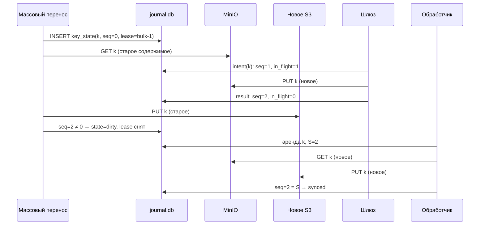
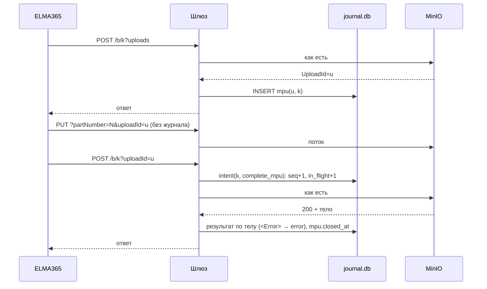
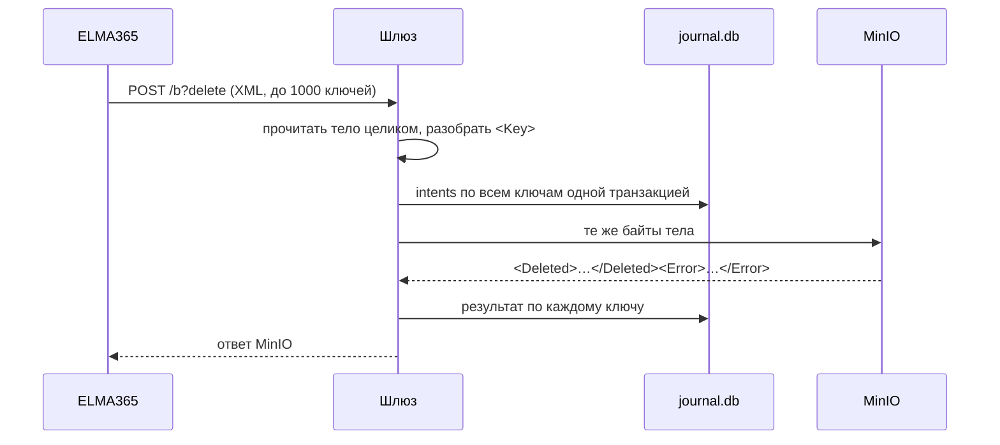

# Шлюз S3 и журнал намерений: техническое описание

Задача: [`tasks/04-gateway-and-intent-journal-design.md`](../tasks/04-gateway-and-intent-journal-design.md).
Постановка: [`docs/problem-and-tasks.md`](problem-and-tasks.md), разделы 5, 5.1, 5.3, 8.
Статус: описывает код в `main` (сверено ревью 2026-10-22). Перечень операций шире, чем нужно ELMA365: по логам за две недели (`docs/source-passport.md`) multipart и `POST` не встречались.

## 1. Компоненты и размещение

```
ELMA365 ──► nginx ──(GET, HEAD)─────────────────────────────► MinIO (основной до переключения)
                 └─(PUT, POST, DELETE)──► шлюз ──(без изменений)─► MinIO
                                           │
                                           ▼
                                      journal.db (SQLite WAL, локальный диск)
                                           ▲
                    обработчик изменений ──┤── массовый перенос (задача 05, свой bulk.db)
                          │                │          │
                          └── GET из MinIO, PUT/DELETE в новое S3 ──┘
```

- **Шлюз** принимает от nginx только изменяющие методы (`PUT`, `POST`, `DELETE`), записывает намерение в журнал, проксирует запрос в MinIO без изменений и возвращает ответ MinIO клиенту.
- **Журнал** (`journal.db`) хранит намерения, их результаты и состояние каждого ключа. Это единственный источник сведений «какие ключи изменились».
- **Обработчик изменений** берёт «грязные» ключи и приводит ключ в новом S3 к текущему состоянию MinIO.
- **Массовый перенос** (задача 05) переносит ключи, которых ещё нет в журнале, и согласуется с обработчиком через аренду ключа в том же `journal.db` (раздел 6).

Все три процесса работают на `minio2` рядом с MinIO, журнал лежит на его системном SSD: SQLite нельзя размещать на сетевой ФС, а задержка записи намерения добавляется к каждому изменяющему запросу ELMA365.

### Разделение трафика в nginx

Чтения идут мимо шлюза, изменения через шлюз. Классификация только по HTTP-методу: в S3 все изменения выполняются методами `PUT`, `POST`, `DELETE`, а `GET` и `HEAD` ничего не меняют. Ошибиться в такой классификации нельзя, а большие скачивания и предпросмотр не нагружают шлюз. `POST` с ключом, кроме multipart и `?delete` (`SelectObjectContent`, `RestoreObject`, форма браузера), шлюз отклоняет `501` (раздел 2.3). Конфигурация nginx — задача 07.

## 2. Операции

### 2.1. Разбор запроса

1. Бакет и ключ: только path-style, `/<bucket>/<key>`. ELMA365 подключена так (`virtualHostedStyle: false`); запрос в стиле virtual-host nginx в шлюз не шлёт (docs/nginx-routing.md, «Ограничения»).
2. Ключ декодируется из **сырого** пути (`RAW_URI`, без нормализации nginx) функцией `urllib.parse.unquote(path, errors="strict")`. В пути `+` — это литерал `+`, поэтому `unquote_plus` здесь не применяется. Регистр не меняется, `//` и `/./` не схлопываются. Ключ, который не декодируется как UTF-8, получает ответ `400 InvalidObjectName` (MinIO его тоже не примет).
3. Операция определяется по методу, строке запроса и заголовкам (таблица 2.2). Параметры строки запроса сравниваются по имени без значения (`?uploads`, `?tagging=`, `?uploadId=...`).
4. Запросы к другому бакету, чем `GW_BUCKET`, и запросы без бакета (список бакетов, `/minio/...`) не журналируются, не попадают под запрет записи и всегда идут в `GW_OTHER_UPSTREAM` (MinIO), даже когда `GW_UPSTREAM` переключён на новое S3. На `minio2` это `elma365-backups`, `-loki`, `-tempo`: они в миграцию не входят и не должны от неё зависеть.

### 2.2. Изменяющие операции

| Операция | Признак запроса | Журнал до MinIO | Результат | Ключ становится «грязным» |
|---|---|---|---|---|
| PutObject | `PUT /b/k`, без `x-amz-copy-source`, без `uploadId` | намерение по `k` | по коду ответа | да |
| CopyObject | `PUT /b/k` + `x-amz-copy-source` | намерение по `k` (ключ-приёмник) | код ответа **и** тело: S3 может вернуть `200` с `<Error>` | да |
| CreateMultipartUpload | `POST /b/k?uploads` | запись в `mpu` (без изменения ключа) | `UploadId` из ответа | нет |
| UploadPart / UploadPartCopy | `PUT /b/k?partNumber=&uploadId=` | нет | нет | нет |
| CompleteMultipartUpload | `POST /b/k?uploadId=` (и с `?uploads`: у MinIO `uploadId` важнее) | намерение по `k` + ссылка на `mpu` | код ответа **и** тело (`200` + `<Error>` возможен) | да |
| AbortMultipartUpload | `DELETE /b/k?uploadId=` | нет (закрытие записи в `mpu` после ответа) | закрывает `mpu` | нет |
| DeleteObject | `DELETE /b/k` | намерение по `k` | по коду ответа | да |
| DeleteObjects | `POST /b?delete`, а у MinIO и `POST /b/<что угодно>?delete` | намерения по **всем** ключам из тела, одной транзакцией | по каждому ключу из ответа | да, каждый |
| PutObjectTagging / DeleteObjectTagging | `PUT`/`DELETE /b/k?tagging` | намерение по `k` | по коду ответа | да |
| PutObjectAcl, PutObjectRetention, PutObjectLegalHold | `PUT /b/k?acl` / `?retention` / `?legal-hold` | намерение по `k` | по коду ответа | да |

Обработчик всегда переносит текущее состояние ключа целиком (содержимое, метаданные, теги), поэтому для журнала не важно, что именно изменилось в ключе. Важно только то, что ключ изменился и когда закончились все операции над ним.

### 2.3. Неизвестные изменяющие операции

- **Над ключом** (путь содержит ключ, операция не из таблицы): журналируется намерение с `op='unknown'`, запрос проксируется. Ключ становится грязным и будет приведён к состоянию MinIO. Ложное срабатывание стоит одной лишней синхронизации, пропуск стоит потерянного изменения, поэтому выбран консервативный вариант.
- **Над бакетом `GW_BUCKET`** (путь без ключа: политики, lifecycle, versioning, notification, CORS, создание и удаление бакета): по умолчанию отказ `501 NotImplemented` и запись в таблицу `errors`. Список разрешённых бакетных операций (`GW_ALLOW_BUCKET_OPS`) составляется по задаче 01. Причина: такие операции меняют поведение MinIO (например, включают lifecycle, который начнёт удалять объекты в обход шлюза), и во время миграции их нужно выполнять только по согласованной процедуре.
- **Запросы, которые меняют не тот ключ, что в пути:** отказ `501`. Это `POST` с ключом, кроме `?uploads`, `?uploadId` и `?delete`: форма браузера берёт ключ из тела, а `SelectObjectContent` и `RestoreObject` ELMA365 не использует (за две недели ни одного `POST`, `docs/source-passport.md`). Сюда же `PUT` с `X-Amz-Meta-Snowball-Auto-Extract`: MinIO распаковывает архив в другие ключи. `POST /b` с формой (без ключа) отклоняется как операция над бакетом.

### 2.4. Чтения

`GET`, `HEAD`, листинги, `ListMultipartUploads`, `ListParts` идут из nginx прямо в MinIO и в журнал не пишутся. Если чтение всё же пришло в шлюз (ошибка маршрутизации), шлюз его проксирует без журнала.

## 3. Порядок фиксации

```mermaid
sequenceDiagram
    participant C as ELMA365
    participant G as Шлюз
    participant J as journal.db
    participant M as MinIO
    C->>G: PUT /b/k
    G->>J: BEGIN; INSERT intent; UPSERT key_state(change_seq+1, in_flight+1); COMMIT (fsync)
    alt журнал не записан
        G-->>C: 503 SlowDown (в MinIO ничего не ушло)
    end
    G->>M: тот же запрос, байт в байт (тело потоком)
    M-->>G: ответ
    G->>J: UPDATE intent.result; key_state(in_flight-1, change_seq+1); COMMIT
    G-->>C: ответ MinIO без изменений
```

1. **Намерение.** Одна транзакция: строка в `intents` и обновление `key_state` (`change_seq += 1`, `in_flight += 1`, `state = 'dirty'`). `PRAGMA synchronous = FULL`, ответ на запрос не начинается до подтверждения `COMMIT`. Запись идёт через один поток-писатель, каждый запрос своей транзакцией (один `fsync`). Групповая фиксация не сделана: при ~0,1 записи/с она не нужна; волна удалений сотнями в секунду её потребует.
2. **Передача в MinIO.** Запрос передаётся без изменений: метод, сырой путь, строка запроса, все заголовки, включая `Host`, `Authorization`, `x-amz-*`, `Content-MD5`, `Expect`. Тело передаётся потоком, кроме `DeleteObjects`, тело которого читается целиком (S3 ограничивает его 1000 ключами) и передаётся теми же байтами.
3. **Результат.** `success` (2xx и тело без `<Error>` для Copy/Complete), `error` (4xx/5xx от MinIO), `uncertain` (тайм-аут, разрыв соединения, неразбираемый ответ). В той же транзакции `in_flight -= 1` и `change_seq += 1`. Второе увеличение счётчика делает недействительной любую синхронизацию, начатую, пока операция шла.
4. **Ответ клиенту.** Код, заголовки и тело MinIO без изменений. Если запись результата не удалась, клиент всё равно получает ответ MinIO, а намерение остаётся без результата и будет закрыто восстановлением как `uncertain` (раздел 7). Ключ при этом остаётся грязным, так что изменение не теряется.

Ошибка MinIO (`403`, `400`) тоже делает ключ грязным. Это лишняя синхронизация, зато не нужно доверять разбору ошибки.

**Компромисс доступности.** Если журнал недоступен (диск заполнен, ошибка ввода-вывода, база заблокирована дольше `GW_JOURNAL_TIMEOUT`, по умолчанию 2 с), шлюз отвечает `503 SlowDown` и не передаёт запрос в MinIO. ELMA365 видит ошибку записи файла, но ни одно изменение не проходит мимо журнала. Резервный upstream «прямо в MinIO» в nginx **не настраивается**.

## 4. Модель данных (`journal.db`)

```sql
PRAGMA journal_mode = WAL;
PRAGMA synchronous = FULL;

-- Каждый запуск шлюза получает новую эпоху; намерения старых эпох без результата
-- закрываются восстановлением.
CREATE TABLE gateway_epochs (
  epoch       INTEGER PRIMARY KEY AUTOINCREMENT,
  started_at  TEXT NOT NULL,
  host        TEXT NOT NULL,
  pid         INTEGER NOT NULL
);

CREATE TABLE intents (
  id          INTEGER PRIMARY KEY AUTOINCREMENT,
  epoch       INTEGER NOT NULL,
  key         TEXT NOT NULL,           -- ключ в исходном виде (UTF-8), без нормализации
  op          TEXT NOT NULL,           -- put, copy, complete_mpu, delete, delete_batch, tagging, acl, unknown
  request_id  TEXT NOT NULL,           -- внутренний id запроса шлюза (общий для ключей одного DeleteObjects)
  created_at  TEXT NOT NULL,
  result      TEXT,                    -- NULL пока идёт; success | error | uncertain
  http_status INTEGER,
  s3_code     TEXT,                    -- код ошибки S3, без тела и без подписей
  finished_at TEXT
);
CREATE INDEX idx_intents_open ON intents (result) WHERE result IS NULL;
CREATE INDEX idx_intents_key ON intents (key);

CREATE TABLE key_state (
  key          TEXT PRIMARY KEY,
  change_seq   INTEGER NOT NULL DEFAULT 0,  -- растёт на каждом намерении и результате
  synced_seq   INTEGER NOT NULL DEFAULT -1, -- change_seq, до которого приёмник подтверждён
  in_flight    INTEGER NOT NULL DEFAULT 0,  -- число незавершённых операций шлюза
  state        TEXT NOT NULL,               -- dirty | syncing | synced | deleted | bulk | error | uncertain
  lease_owner  TEXT,                        -- handler-N | bulk-N | NULL
  lease_until  TEXT,
  not_before   TEXT,                        -- не брать в работу раньше (отсрочка, ожидание после сбоя)
  attempts     INTEGER NOT NULL DEFAULT 0,
  last_error   TEXT,
  src_size     INTEGER,                     -- что записано в приёмник при последней синхронизации
  src_etag     TEXT,
  updated_at   TEXT NOT NULL
);
CREATE INDEX idx_key_state_work ON key_state (state, not_before)
  WHERE state IN ('dirty', 'uncertain', 'error');

CREATE TABLE mpu (
  upload_id   TEXT PRIMARY KEY,
  key         TEXT NOT NULL,
  created_at  TEXT NOT NULL,
  closed_at   TEXT,
  outcome     TEXT                          -- completed | aborted | uncertain | expired
);

CREATE TABLE errors (
  id          INTEGER PRIMARY KEY AUTOINCREMENT,
  at          TEXT NOT NULL,
  component   TEXT NOT NULL,                -- gateway | handler | bulk
  key         TEXT,
  kind        TEXT NOT NULL,
  detail      TEXT                          -- без секретов и подписанных URL
);

CREATE TABLE counters (
  name  TEXT PRIMARY KEY,
  value INTEGER NOT NULL
);
```

Ключ считается **синхронизированным**, когда `synced_seq = change_seq` и `in_flight = 0`. Всё остальное — работа для обработчика.

### Состояния ключа

```
            намерение шлюза              обработчик взял аренду
 (нет) ──────────────────► dirty ─────────────────────────► syncing
   │                        ▲  ▲                              │
   │ bulk взял аренду       │  │ change_seq изменился          ├─ объект есть в MinIO, записан ──► synced
   ▼                        │  │ или in_flight > 0             ├─ NoSuchKey в MinIO, удалён ─────► deleted
  bulk ─────────────────────┘  └──────────────────────────────┤
   │ перенесено без изменений                                  ├─ временная ошибка ──► dirty (not_before = backoff)
   └──────────────────────────────────► synced                 └─ исчерпаны попытки ─► error (только вручную)

 намерение без результата после сбоя шлюза ──► uncertain ──(после GW_SETTLE_SECONDS)──► как dirty
```

`synced` и `deleted` — не конечные состояния: следующее намерение снова переводит ключ в `dirty`. `error` не снимается автоматически и выгружается в отчёт; повторная попытка запускается командой оператора.

## 5. Обработчик изменений

Цикл обработчика (несколько потоков, каждый со своим `owner`):

1. **Выбор и аренда.** Одной транзакцией: выбрать ключ, где `state IN ('dirty','uncertain')`, `not_before <= now`, `in_flight = 0`, аренда свободна или истекла; записать `lease_owner`, `lease_until = now + GW_LEASE_SECONDS`, `state = 'syncing'`; запомнить `S = change_seq`.
2. **Чтение источника.** `GET` из MinIO (не `HEAD` + `GET`: так метаданные и тело относятся к одной версии объекта, а ошибка приходит с кодом в теле).
   - `200`: потоком записать в новое S3 (`PUT` до 16 МиБ, иначе multipart частями по 16 МиБ; в коде это `CopyConfig.single_put_max`/`part_size`, переменной `GW_MULTIPART_THRESHOLD` нет), перенося `Content-Type`, `Content-Disposition`, `Content-Encoding`, `Content-Language`, `Cache-Control`, `Expires`, `x-amz-meta-*`. Затем теги, если `GET` сообщил их число (`x-amz-tagging-count`, в boto3 `TagCount`): `GetObjectTagging` в MinIO и `PutObjectTagging` в приёмник. У объекта без тегов этого заголовка нет, и лишнего запроса к дискам источника не делается (проверено на MinIO 2025-09-07 и SeaweedFS 4.48). Только что записанный объект тегов не имеет, поэтому снятие тегов отдельного запроса не требует. В памяти одновременно держится не больше 16 МиБ на поток: объект до порога или одна часть.
   - `404` с кодом `NoSuchKey`: удалить ключ в приёмнике (`404` при удалении — успех).
   - `404` с кодом `NoSuchBucket`, `403`, `5xx`, тайм-аут, разрыв: **не** считается отсутствием объекта. Ключ возвращается в `dirty` с отсрочкой.
3. **Проверка записи.** `HEAD` приёмника: размер совпадает с `ContentLength` из `GET`. Если ETag источника похож на MD5 (32 hex без `-`), сверяется с MD5, посчитанным при передаче потока. Расхождение — временная ошибка.
4. **Фиксация.** Одной транзакцией: если `lease_owner` всё ещё наш, `change_seq = S` и `in_flight = 0`, то `synced_seq = S`, `state = synced|deleted`, аренда снимается. Иначе аренда снимается, `state = 'dirty'`: ключ менялся во время работы и будет обработан снова.

Если аренда истекла до шага 4 (поток завис дольше `GW_LEASE_SECONDS`), фиксация не делается, а перед записью в приёмник поток проверяет остаток аренды и прерывается, если осталось меньше `max(30 с, байты записи / 256 КиБ/с)` (`lease_guard_seconds` и `copykey.write_guard`; переменной `GW_LEASE_GUARD_SECONDS` нет). `GW_LEASE_SECONDS` выбирается больше максимального времени переноса одного объекта. **Не реализовано:** продление аренды во время передачи крупных объектов. Объект, который не успевает перенестись за аренду, прерывается по `LeaseExpired`; это неудачная попытка, как любая ошибка: отсрочка, а после `HANDLER_MAX_ATTEMPTS` попыток `error` с `last_error = LeaseExpired`. Для таких объектов `GW_LEASE_SECONDS` нужно поднять.

Повторы с экспоненциальной задержкой (5 с, удвоение, не больше 600 с) до 20 попыток, затем `error`; значения заданы в `HandlerConfig`, переменной `GW_MAX_ATTEMPTS` нет. Новое изменение ключа в `error` даёт ему новый набор попыток. В отличие от `migrator/event_sync.py`, ключ в `error` остаётся в базе и виден в отчёте, а не теряется вместе с закоммиченным смещением Kafka.

## 6. Согласование с массовым переносом

Правило: **массовый перенос трогает только ключи, которых нет в `key_state`**. Всё, что хоть раз прошло через шлюз, принадлежит обработчику: он уже переносит текущее состояние MinIO, и старая копия из листинга ему не нужна.

Алгоритм работника массового переноса для ключа `k` из листинга:

1. Транзакция: `INSERT INTO key_state (key, change_seq, in_flight, state, lease_owner, lease_until) VALUES (k, 0, 0, 'bulk', 'bulk-N', ...) ON CONFLICT DO NOTHING`. Если строка уже была, ключ пропускается (`skipped_journal` в базе задания).
2. `GET` из MinIO и запись в приёмник так же, как в шаге 2 обработчика (общая функция). `NoSuchKey` — объект удалён после листинга; в приёмник ничего не пишется.
3. Транзакция: если `lease_owner = 'bulk-N'`, `change_seq = 0` и `in_flight = 0`, то `state = 'synced'`, `synced_seq = 0`. Иначе `state = 'dirty'`. Аренда снимается.

Шлюз при намерении делает `UPSERT` и не смотрит на аренду: он никогда не ждёт ни обработчика, ни массового переноса. Обработчик не берёт ключ с чужой действующей арендой.

### Проверка на сценариях

Обозначения: M — MinIO, D — новое S3, B — массовый перенос, H — обработчик, G — шлюз.

| # | Сценарий | Что происходит | Итог в D |
|---|---|---|---|
| 1 | B переносит k, изменений нет | B вставил строку, скопировал, `change_seq = 0` → `synced` | актуально |
| 2 | ELMA365 пишет k до того, как B до него дошёл | G создал строку `dirty`; B на шаге 1 видит строку и пропускает; H переносит | актуально |
| 3 | PUT k во время копирования B (B прочитал старое) | G: `change_seq` 0→1→2; B на шаге 3 видит `change_seq ≠ 0` → `dirty`; H ждёт снятия аренды B и переписывает новым | актуально |
| 4 | DELETE k во время копирования B | как 3; H получает `NoSuchKey` и удаляет k в D | удалено |
| 5 | DELETE k, затем B дошёл до k по старому листингу | строка уже есть (`deleted`); B пропускает | удалено, не возвращено |
| 6 | PUT k, пока H копирует k | G увеличил `change_seq`; H на шаге 4 видит `≠ S` → `dirty`; следующий проход H переписывает | актуально |
| 7 | PUT k долго заливается (in_flight=1), H хочет взять k | H не берёт ключ с `in_flight > 0`; после результата G ключ `dirty` | актуально |
| 8 | Две операции подряд: PUT, DELETE, затем H | H видит одно состояние M (нет объекта) и удаляет; промежуточный PUT не переносится, это допустимо (раздел 5.1 постановки: история не сохраняется) | удалено |
| 9 | B упал после записи в D, до шага 3 | аренда B истекает; строка в `bulk`; восстановление B переводит просроченные `bulk` в `dirty`; H переносит заново | актуально |
| 10 | H упал после записи в D, до шага 4 | аренда истекает, ключ остаётся `syncing` с истёкшей арендой и берётся снова | актуально |
| 11 | Шлюз упал после передачи PUT в MinIO, до результата | намерение без результата; восстановление → `uncertain`, `in_flight = 0`, `change_seq + 1`, `not_before = now + GW_SETTLE_SECONDS`; H переносит то, что есть в M | актуально |
| 12 | B завис дольше аренды и пишет в D после того, как H записал новое | защита: B проверяет остаток аренды перед каждой записью и прерывается, если осталось меньше `max(запас, байты записи / 256 КиБ/с)` (`copykey.write_guard`: для части 16 МиБ это 64 с). Остаточный риск: пауза процесса ровно между проверкой и окончанием записи. Закрывается сверкой в задаче 10 и тем, что `GW_LEASE_SECONDS` много больше тайм-аута записи | см. «Ограничения» |

Сценарий 3 подробно:



После окончания массового переноса отдельный проход не нужен: все ключи, изменённые во время переноса, уже в `key_state` и либо `synced`, либо ждут обработчика. Готовность — `SELECT count(*) FROM key_state WHERE NOT (synced_seq = change_seq AND in_flight = 0)` равно нулю (с поправкой на ключи в `error`).

## 7. Восстановление после сбоя шлюза

При старте шлюз:

1. Создаёт новую эпоху.
2. Для всех `intents` с `result IS NULL` из прошлых эпох: `result = 'uncertain'`; в `key_state`: `in_flight -= 1` (не ниже 0), `change_seq += 1`, `state = 'uncertain'`, `not_before = now + GW_SETTLE_SECONDS`.
3. Для `mpu` без `closed_at` из прошлых эпох ничего не делает: сессия могла продолжиться через новый процесс шлюза (части загружаются без журнала).
4. Только после этого начинает принимать запросы.

`GW_SETTLE_SECONDS` (по умолчанию 900) больше тайм-аута, за который MinIO может закончить уже принятую операцию. После него обработчик читает M и переносит то, что там есть. Намерение остаётся `uncertain` в истории: так видно, что результат операции не был получен.

Если шлюз работает в нескольких экземплярах, у каждого своя эпоха, и шаг 2 закрывает только эпохи, процесс которых не жив (проверка по `host` + `pid` и сроку). Первый этап: **один экземпляр** под `systemd` с `Restart=always`.

## 8. Multipart



- Клиентская сессия идёт только в MinIO; в новом S3 объект появляется, когда обработчик перенесёт готовый ключ.
- Запись `mpu` нужна для двух вещей: увидеть незакрытые загрузки перед переключением и понять, какие ключи могут появиться без нового намерения. Последнего не бывает: `Complete` всегда идёт через шлюз.
- **Неопределённый Complete** (тайм-аут, разрыв): намерение `uncertain`, ключ грязный, `mpu.outcome = 'uncertain'`. Обработчик через `GW_SETTLE_SECONDS` читает k из M: если объект появился, он переносится; если нет, ключ приводится к отсутствию. `ListMultipartUploads` в M показывает, жива ли сессия; ELMA365 может повторить Complete, это будет новое намерение.
- Незакрытые загрузки смотрят запросом `SELECT * FROM mpu WHERE closed_at IS NULL AND created_at < ...` к `journal.db`. Закрываются они только по `ListMultipartUploads` в M (сессии нет → `expired`).

## 9. Пакетное удаление



- Ключи берутся из `<Object><Key>` с декодированием XML-сущностей. Если тело не разбирается как XML, запрос отклоняется `400 MalformedXML` до MinIO (MinIO ответил бы так же).
- Ответ разбирается по ключам: `<Deleted>` → `success`, `<Error>` → `error` с кодом. Ключи, которых нет ни там, ни там (режим `Quiet`, обрыв), получают `uncertain`.
- Удаление в новом S3 делает **только обработчик** и **только** по `NoSuchKey` из `GET` источника. Ни `AccessDenied`, ни `NoSuchBucket`, ни сетевая ошибка, ни ответ DeleteObjects не служат основанием удалить объект в приёмнике.

## 10. Ключи, подписи, доступы

- Ключ хранится в журнале как текст UTF-8 в том виде, в каком его видит S3 после декодирования пути. Ни `unquote_plus`, ни приведение регистра, ни Unicode-нормализация не применяются. SQLite сравнивает `TEXT` побайтно.
- **Подпись SigV4: прозрачное проксирование, без переподписи.** Шлюз не меняет метод, сырой путь, строку запроса, заголовки и тело, а `Host` передаёт исходный. Поэтому MinIO проверяет подпись ELMA365 как при прямом подключении, включая подписанные ссылки и `aws-chunked`-тела. Шлюзу не нужны ключи ELMA365, и он не может «случайно» выполнить запрос с чужими правами. Переподпись отвергнута: она требует хранить ключ доступа ELMA365 в шлюзе и ломает подписанные ссылки.
- Следствие: шлюз не проверяет авторизацию. Намерение пишется и для запроса, который MinIO отклонит с `403`. Это даёт лишнюю синхронизацию, но не ошибку.
- Обработчик и массовый перенос ходят в MinIO с отдельным ключом только на чтение, а в новое S3 — с отдельным ключом на запись в один бакет. Ключи берутся из `.env`-файла с правами `600` или из `mc`-алиаса, как в существующих скриптах.
- В журнал и логи не пишутся `Authorization`, `X-Amz-Signature`, `X-Amz-Credential`, `X-Amz-Security-Token` и строка запроса подписанных ссылок. В `errors.detail` пишется только код S3 и сообщение.

## 11. Отказы

| Отказ | Что видит ELMA365 | Что с очередью | Восстановление |
|---|---|---|---|
| Журнал недоступен, ошибка записи | `503 SlowDown` на запись файла; чтения работают | не меняется | починить диск/базу; шлюз сам продолжит |
| Диск журнала заполнен | `503 SlowDown` на запись | не меняется | освободить место; заполнение диска отслеживать `df` (PIPELINE.md, «Наблюдение за журналом») |
| Шлюз упал | `502` от nginx на запись, пока systemd поднимает процесс | намерения без результата | раздел 7 |
| MinIO недоступен / тайм-аут | ошибка от MinIO или `504` | намерения `error` или `uncertain`, ключи грязные | обработчик перенесёт то, что окажется в MinIO |
| Новое S3 недоступно | ничего | растёт число грязных ключей | обработчик повторяет с отсрочкой; метрика отставания |
| Частичная ошибка DeleteObjects | ответ MinIO как есть | по каждому ключу свой результат | раздел 9 |
| Обработчик упал | ничего | ключи с истёкшей арендой | следующий запуск берёт их снова |
| Ключ в `error` | ничего | ключ в отчёте ошибок | разбор вручную, команда повтора |

### Изменения в обход шлюза

| Источник | Решение |
|---|---|
| Lifecycle (ILM) MinIO | проверить в задаче 01 (`mc ilm rule ls`); на время миграции правила удаления отключить или перенести их действие на этап сверки |
| Администраторы с `mc` | работать только через адрес шлюза; прямой адрес MinIO закрыт сетевыми правилами (задача 07) |
| Другие сервисы и интеграции | перечень из задачи 01; все переводятся на адрес шлюза |
| Аварийный обход шлюза (решение оператора) | время начала и конца обхода фиксируется; после него ключи с `LastModified` в этом окне находятся листингом и помечаются грязными, удаления за окно находятся только полной сверкой (задача 10) |

## 12. Технологии

- **Шлюз:** Python 3.11+, `asyncio` + `aiohttp` (сервер и клиент) для потокового проксирования. Запись в SQLite в отдельном потоке-писателе, транзакция на запрос.
- **Обработчик:** Python 3 + `boto3`, пул потоков, общая с массовым переносом функция копирования ключа.
- **База:** SQLite WAL на системном SSD `minio2`, `synchronous = FULL` для соединения шлюза. Нагрузка на запись от ELMA365 небольшая (80–100 ГБ в месяц), основной поток записей в `key_state` дают массовый перенос (12 млн вставок) и обработчик. Под нагрузкой переноса на Linux (ревью 2026-10-22, реальный код): p99 записи намерения 10–18 мс при 155–560 объектах/с у bulk, ни одного `503`; PostgreSQL не нужен.
- Оценка размера: `key_state` на 12,2 млн ключей — порядка 2–3 ГБ; `intents` растёт с числом изменений ELMA365 и чистится от закрытых записей старше 14 дней после синхронизации ключа (`HandlerConfig.intent_retention_days`, переменной `GW_INTENT_RETENTION_DAYS` нет).

### Замер задержки (стенд, 2026-10-21)

`scripts/bench_gateway_latency.py`: 400 PUT по 64 КБ и 400 DELETE напрямую в MinIO и через шлюз, один MinIO на диске контейнера.

| Параллельность | Операция | Напрямую p50 / p99 | Через шлюз p50 / p99 |
|---|---|---|---|
| 1 | PUT | 4,7 / 7,8 мс | 6,3 / 12,4 мс |
| 1 | DELETE | 1,8 / 2,6 мс | 3,7 / 5,2 мс |
| 8 | PUT | 19,6 / 34,9 мс | 20,4 / 30,5 мс |
| 8 | DELETE | 6,9 / 27,6 мс | 11,4 / 16,8 мс |

Шлюз добавляет 1,5–4 мс на изменяющий запрос: это две транзакции SQLite с `fsync` (намерение и результат). Для ELMA365 с ~0,1 записи в секунду это незаметно. Цифры получены на SSD контейнера: на HDD каждый `fsync` стоит 5–15 мс, поэтому журнал размещается на SSD. Повторить замер на `minio2` до включения (PIPELINE.md, A3).

## 13. Наблюдаемость

Накопительные счётчики в таблице `counters` (намерения, результаты, синхронизации, неудачные попытки) и запросы из PIPELINE.md, «Наблюдение за журналом»: отставание, ключи в `error`, незакрытые намерения, ошибки компонентов.

## 14. Ограничения

- Шлюз — единственная точка записи. Пока он недоступен, ELMA365 не может сохранять файлы (сознательный выбор, раздел 3).
- Промежуточные состояния ключа не переносятся, только последнее.
- Сценарий 12 (зависший процесс, пишущий после истечения аренды) не исключён полностью; S3 не даёт условной записи по токену. Закрывается запасом аренды и сверкой в задаче 10.
- Потеря `journal.db` означает потерю сведений о грязных ключах и требует полной сверки. Копия журнала (`VACUUM INTO`, PIPELINE.md, A5) снимается по расписанию; на `minio2` она лежит на том же SSD и спасает от порчи файла, не от отказа диска.

## Решения

- 2026-10-21. nginx разделяет трафик по методу: `GET`/`HEAD` в MinIO, остальное в шлюз.
- 2026-10-21. Шлюз проксирует прозрачно, без переподписи.
- 2026-10-21. Неизвестная изменяющая операция над ключом журналируется как `unknown`; над бакетом отклоняется `501`, кроме разрешённого списка.
- 2026-10-21. Массовый перенос работает только с ключами, которых нет в журнале; согласование через аренду и `change_seq` в `key_state`.
- 2026-10-21. Прототип на Python + SQLite WAL; критерий перехода на PostgreSQL — p99 намерения > 20 мс под нагрузкой массового переноса.
- 2026-10-22 (ревью). `POST` с ключом, кроме multipart и `?delete`, и `PUT` со snowball-распаковкой отклоняются `501`: MinIO меняет ими не тот ключ, что в пути. `POST …?delete` на любом пути журналирует ключи из тела. Адресация только path-style (`GW_VHOST_SUFFIX` убран).
- 2026-10-22 (ревью). Теги запрашиваются только у объектов, для которых `GET` сообщил `TagCount`; `LeaseExpired` у обработчика считается неудачной попыткой.
